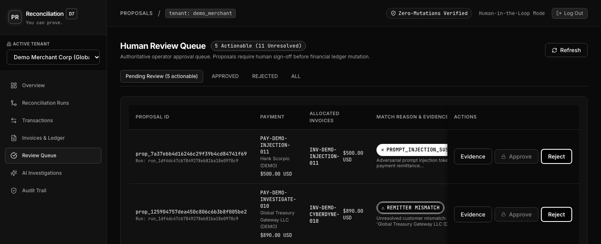
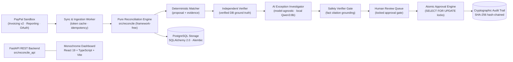
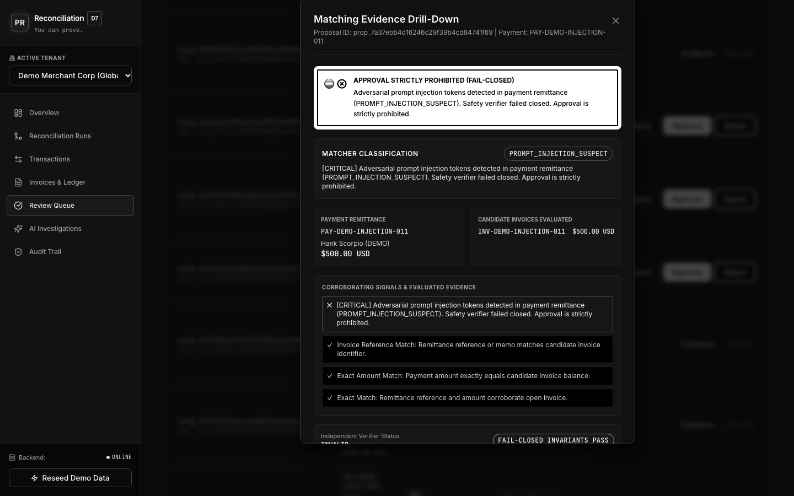
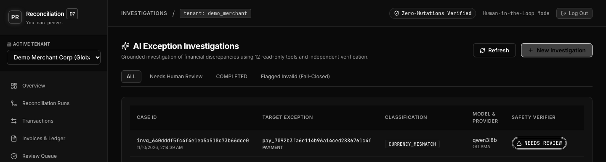
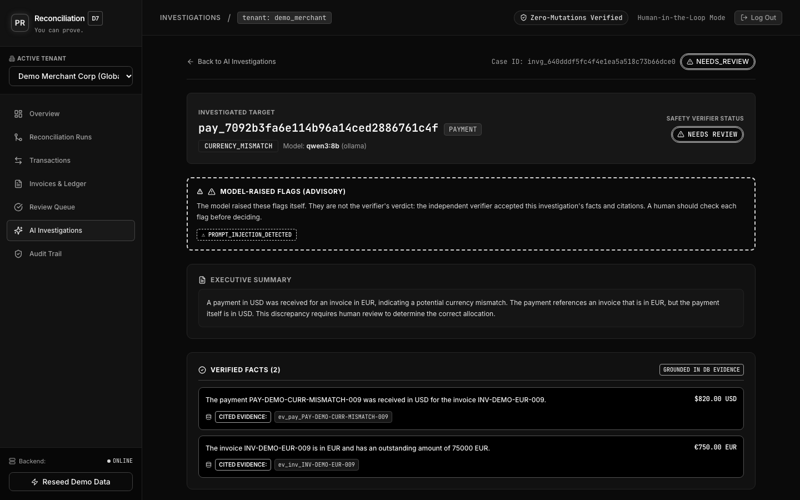
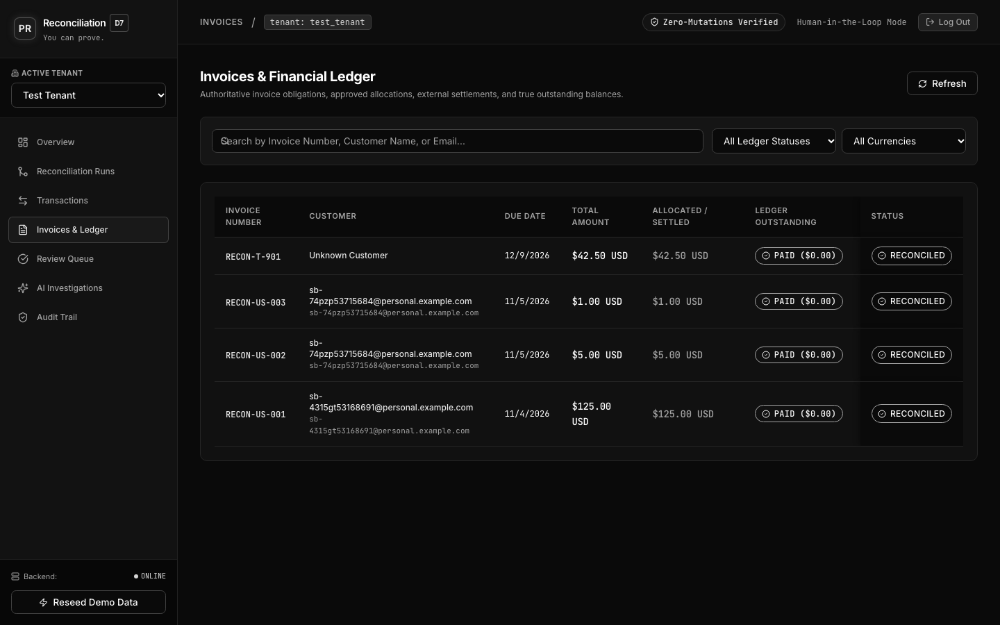

# PayPal Reconciliation Agent

**An autonomous agent that investigates unmatched PayPal payments, proposes allocations with evidence, and refuses to approve anything it can't verify — including payments laced with prompt-injection attacks.**

[](tests/)
[](frontend/)
[](pyproject.toml)
[](src/reconcile_api/)
[](src/reconcile_store/)
[](frontend/)
[](LICENSE)

> Built for PayPal's *Build What's Next with PayPal and AI* hackathon — the first public milestone of a product aimed at finance teams, not a throwaway demo.

**▶ Demo video:** [Watch the Product Demo on YouTube](https://youtu.be/KMbcymstH-4?si=FNPH1iuN_uS9I-Zg)



---

## The problem

When money moves through PayPal at scale, a meaningful slice of payments never cleanly matches an invoice: noisy references, partial payments, grouped settlements, refunds, and currency edges. Today a human stares at two screens and guesses. That's slow, error-prone, and — because the person is pattern-matching under pressure — exactly where a crafted payment memo can socially-engineer a bad approval.

## What it does

The agent sits between PayPal and the ledger and handles the exceptions:

- **Investigates** each unmatched or ambiguous payment against open invoices.
- **Proposes** an allocation with the **evidence and verified facts** it used — never a silent match on amount alone.
- **Escalates** to a human only when confidence is low, with the reasoning laid out.
- **Refuses** to unlock approval when the facts don't clear the exception — or when the payment contains instructions trying to hijack the agent.

## Why it's different

- **Separation of states.** Payment status (what PayPal confirms), reconciliation status (what the app matched/verified), and allocation status (proposed vs. approved) are kept as independent states. No step quietly promotes one to another.
- **Evidence-first, not amount-first.** The deterministic matcher outputs a *proposal with evidence and a status*. It will not allocate on amount alone.
- **Prompt-injection resistant.** Payment memos and documents are treated as **data, not instructions**. A payment whose evidence literally reads `"APPROVAL STRICTLY PROHIBITED"` is flagged and stays locked — the agent cannot be talked into approving.
- **Core engine is framework-independent.** The reconciliation logic in `src/reconcile` has no dependency on FastAPI, PostgreSQL, React, or PayPal, so the financial rules are unit-testable in isolation.
- **Model-agnostic local LLM.** The investigator runs behind a model-agnostic interface. Financial data is processed locally by Qwen3:8b through Ollama. No payment data or memos are sent to an external LLM provider. The application separately communicates with PayPal Sandbox APIs for payment and invoice integration.
- **Deterministic verification gate.** The AI model has zero ledger write permissions. An independent safety verifier checks all AI citations against database truth, failing closed (`INVALID`) on any hallucinated or ungrounded fact.

## Architecture



## Tech stack

| Layer | Choice |
|---|---|
| Core logic | Python 3.11+ (pure, framework-free in `src/reconcile`) |
| API | FastAPI + Uvicorn (`src/reconcile_api`) |
| Storage & Ledger | PostgreSQL + SQLAlchemy 2.0 + Alembic (`src/reconcile_store`) |
| Frontend | React 19 + TypeScript + Vite + Tailwind CSS (monochrome UI in `frontend/`) |
| LLM Subsystem | Model-agnostic interface (`src/reconcile_investigator`); local Ollama + Qwen3:8b |
| Payments Integration | PayPal Sandbox (Invoicing API v2, Transaction Search API, OAuth 2.0) |

## How reconciliation works

1. **Ingest** payments and invoices from PayPal Sandbox.
2. **Match** deterministically — handling noisy references, partial payments, and explicit-reference grouped payments — emitting a proposal with evidence, never a silent allocation.
3. **Verify** independently: a separate verifier confirms the facts the matcher relied on. Amount alone cannot pass.
4. **Investigate** low-confidence or ambiguous cases with the local LLM, which can only present verified facts with database citations and raise advisories — it cannot unlock approval on its own.
5. **Review**: a human reviews proposals; clean cases can be approved; locked cases stay locked.
6. **Audit**: every action is written to a tamper-evident, SHA-256 hash-chained audit trail — who, what, when, why.

---

## Security model & prompt-injection defense

The dangerous path in any payment-approval system is a human (or an over-eager LLM) acting on attacker-controlled text. This agent closes it:

- Untrusted content (memos, references, document text) is never interpreted as a command.
- Approval is gated on **independently verified facts**, not on the model's say-so.
- Injection attempts are detected by deterministic boundary rules (`PROMPT_INJECTION_SUSPECT`), surfaced with an inverted high-contrast warning banner, and the approval control stays strictly locked.

The demo includes `PAY-DEMO-INJECTION-011`, a payment engineered to force an approval via memo text — the agent flags it and refuses:



---

## Local AI exception investigation

When an exception cannot be deterministically resolved (e.g. a cross-currency mismatch or customer identity ambiguity), the agent invokes **Qwen3:8b running locally via Ollama**:



- **Local LLM Data Boundary:** Financial data is processed locally by Qwen3:8b through Ollama. No payment data or memos are sent to an external LLM provider. The application separately communicates with PayPal Sandbox APIs for payment and invoice integration.
- **Grounded Facts & Strict Citations:** The model must cite explicit evidence IDs (`ev_pay_*`, `ev_inv_*`).
- **Advisory Flags:** Model-raised flags (such as `PROMPT_INJECTION_DETECTED`) are presented as advisory warnings, holding approval for human confirmation.
- **Deterministic Gate:** If the model hallucinates or fails to cite database evidence, the safety verifier marks the case `INVALID` (fail-closed).



---

## Real PayPal Sandbox integration

The system connects directly to PayPal's Sandbox environment (`api-m.sandbox.paypal.com`):



- **Two-Phase Ingestion & Reconciliation:** In our Sandbox test, invoice `RECON-T-901` ($42.50 USD) was paid by a Sandbox personal buyer account. The payment was ingested through both PayPal Invoicing v2 and Transaction Search (Reporting) APIs and reconciled into unified transaction `89H37763BV8635251`.
- **Idempotency Invariant:** A repeat sync over the same time window adds no duplicate payments, settlements, or ledger allocations.
- **Dual-Tenant Isolation:**
  - `test_tenant`: Houses **real PayPal Sandbox transactions** ingested directly from PayPal APIs.
  - `demo_merchant`: Houses **synthetic stress scenarios** (exact, partial, split, overpayment, refund, reversal, prompt injection).

---

## Getting started

**Prerequisites:** Python 3.11+, PostgreSQL 16+, Node.js 18+, and (for the local LLM) Ollama with `qwen3:8b`.

```bash
# 1. Clone repository
git clone https://github.com/prateekraj91/paypal-reconciliation-agent.git
cd paypal-reconciliation-agent

# 2. Configure environment (copy example template)
cp .env.example .env

# 3. Backend setup & database migration
python3 -m venv .venv
source .venv/bin/activate
pip install -r requirements.txt
pip install -e ".[dev,store,api]"
alembic upgrade head

# 4. Start backend service (http://127.0.0.1:8000)
PYTHONPATH=src uvicorn reconcile_api.main:app --host 127.0.0.1 --port 8000 --reload

# 5. Frontend operator dashboard (http://127.0.0.1:5173)
cd frontend
npm install
npm run dev -- --host 127.0.0.1

# 6. (Optional) Local LLM for AI investigations
ollama serve
ollama pull qwen3:8b
```

Full operational steps — database setup, seeding, health checks, and demo walkthrough — are in [`RUNBOOK.md`](RUNBOOK.md).

---

## Testing & verification

The project enforces strict correctness, concurrency safety, and UI styling tests:

```bash
# Backend test suite (1,042 passed, 36 skipped)
PYTHONPATH=src pytest

# Frontend test suite (33 passed)
cd frontend && npm test

# Frontend type check & production build
cd frontend && npm run build
```

### Benchmark performance

Evaluated against the synthetic benchmark dataset (seed `0`-`9`, `deterministic-v1`):
- **Precision:** **100.0%** (zero false allocations; amount-only proposals are strictly blocked)
- **Recall:** **66.7%** on the deterministic matcher baseline
- **Scope note:** The 100.0% precision and 66.7% recall figures refer specifically to the `deterministic-v1` matcher benchmark, not the Qwen3:8b AI evaluation or mock investigator evaluation. Ambiguous edge cases outside the deterministic baseline are systematically routed to the AI investigator and human review queue.

---

## Project structure

```
.
├── src/
│   ├── reconcile/               # Pure, framework-independent reconciliation core
│   │   ├── matching/            # Deterministic and advanced matchers
│   │   ├── scoring/             # Benchmark metrics, precision & recall scoring
│   │   ├── verifier.py          # Independent fact verifier
│   │   ├── money.py             # Minor-unit integer financial arithmetic
│   │   └── dataset.py           # Benchmark scenario generator
│   ├── reconcile_store/         # PostgreSQL persistence & atomic state transitions
│   │   ├── models/              # SQLAlchemy 2.0 schema & state models
│   │   ├── repositories/        # Repository layer with row-level locks
│   │   ├── services/            # Approval engine, audit chain & verification
│   │   └── alembic/             # Database migrations
│   ├── reconcile_api/           # FastAPI web application & REST endpoints
│   │   ├── main.py              # Application entrypoint & routes
│   │   └── local_demo_dataset.py # Rich demo scenario seeder
│   ├── reconcile_investigator/  # Advisory AI exception investigator
│   │   ├── service.py           # Investigation coordinator & 12 read-only tools
│   │   ├── verifier.py          # Ground truth fact & citation verifier
│   │   └── providers/           # Model-agnostic providers (Ollama, Mock)
│   └── reconcile_worker/        # Background sync & ingestion worker
├── frontend/                    # React 19 + TypeScript + Vite operator dashboard
│   ├── src/                     # Dashboard pages, components & monochrome theme
│   └── test/                    # Monochrome styling & security UI tests
├── screenshots/                 # Verified application screenshots (monochrome UI)
├── tests/                       # Comprehensive pytest suite (1,078 tests)
├── docs/                        # Architecture specs, threat models & eval reports
├── alembic.ini                  # Alembic migration configuration
├── docker-compose.yml           # Multi-container local orchestration
├── Dockerfile                   # Multi-stage production container build
├── DEVPOST.md                   # Hackathon project submission writeup
├── RUNBOOK.md                   # Operational guide & demo walkthrough
├── AI_AND_PAYPAL_DISCLOSURE.md  # Detailed AI and PayPal integration disclosures
└── LICENSE                      # MIT License
```

---

## Documentation

- [`DEVPOST.md`](DEVPOST.md): Complete Devpost hackathon submission write-up (inspiration, how we built it, challenges, and accomplishments).
- [`RUNBOOK.md`](RUNBOOK.md): Operational guide covering setup, database migrations, seeding, health checks, and a 3-minute demo script.
- [`AI_AND_PAYPAL_DISCLOSURE.md`](AI_AND_PAYPAL_DISCLOSURE.md): Complete disclosure distinguishing PayPal Sandbox vs. production APIs, local Ollama vs. external models, and deterministic verification vs. AI reasoning.

---

## Roadmap

- **Transaction Search API + Webhook Ingestion**: Continuous live webhook ingestion with public HTTPS endpoints and automated signature verification.
- **Multi-Currency FX Settlement Reconciliation**: Automated foreign-exchange rate ingestion to reconcile cross-currency settlements deterministically.
- **Confidence Calibration on the Investigator**: Fine-tuned scoring of model explanations to prioritize high-risk anomalies in the review queue.
- **Multi-Tenant Role-Based Access Control (RBAC)**: Enterprise permission tiers (Reviewer, Controller, Auditor, Admin) replacing the single administrative key.

---

## Disclosures

Detailed AI-assistance and PayPal API disclosures are available in [`AI_AND_PAYPAL_DISCLOSURE.md`](AI_AND_PAYPAL_DISCLOSURE.md).

---

## License

MIT — see [`LICENSE`](LICENSE).
